# Sarp Can Karaman

**Machine learning · Data · Cloud**

[Portfolio](https://sarpowsky.github.io) &nbsp; / &nbsp; [LinkedIn](https://www.linkedin.com/in/sarpcankaraman) &nbsp; / &nbsp; [Email](mailto:sarpcankaraman@gmail.com)

---

### Hello, I'm Sarp.

I'm a fourth-year Computer Engineering student at **Haliç University**, graduating in June 2027 (expected). I like working across the full path from data and models to the infrastructure that makes them useful.

I've worked in data analysis at **lodos.**, cloud and DevOps at **Soliner**, and AI engineering at **BLUESENSE**. I also built [KaBooom](https://kabooom.live) and organize **GDG on Campus Haliç**.

`Istanbul, Türkiye` &nbsp; · &nbsp; `Google Cloud Associate Cloud Engineer`

---

### Selected work

**[01 / KaBooom ↗](https://kabooom.live)** &nbsp; `REAL-TIME PRODUCT`

A live multiplayer quiz platform for community events. Players join from a browser; the server handles the game loop, answer locking, and timing.

TypeScript · React · Node.js · Socket.IO · Astro · Cloudflare

**[02 / K8s Carbon Advisor ↗](https://github.com/sarpowsky/k8s-carbon-advisor)** &nbsp; `CLOUD & DEVOPS`

A FastAPI service on GKE Autopilot for Kubernetes workload rightsizing and carbon footprint estimation, with CI/CD and autoscaling.

Python · FastAPI · Docker · Kubernetes · GKE · GitHub Actions

**03 / Implicit-Feedback Recommender** &nbsp; `MACHINE LEARNING`

Benchmarked recommendation models on **2.7 million e-commerce interactions**, exploring the trade-off between ranking accuracy and catalog coverage.

Python · PyTorch · Implicit · SciPy

<strong>More projects</strong> &nbsp; ↗ &nbsp; experimentation, analytics &amp; systems

 

**Uplift Modeling for Campaign Targeting** — Compared causal models across 13 million randomized marketing records and translated the results into an expected-profit targeting curve.

**F1 Analytics Warehouse** — Built a PostgreSQL and dbt warehouse over seven seasons of Formula 1 timing data, with automated tests and optimized analytical queries.

**A/B Testing & Experimentation Toolkit** — Built a Python library for power analysis, sequential testing, variance reduction, and experiment readouts; validated estimators with Monte Carlo simulations.

**[MSI Katana RGB Controller](https://github.com/sarpowsky/msi-katana-rgb)** — Built a Linux GUI for keyboard lighting control by reverse-engineering the USB HID protocol.

---

### Tools of the trade

| Area | Tools & interests |
| :--- | :--- |
| **Programming & data** | Python · SQL · PostgreSQL · Pandas · NumPy · Polars · dbt · Git · Linux |
| **ML & experimentation** | PyTorch · scikit-learn · LightGBM · XGBoost · recommender systems · causal inference · A/B testing |
| **Cloud & engineering** | Google Cloud · Docker · Kubernetes · FastAPI · GitHub Actions · infrastructure as code · monitoring |
| **Analytics** | Metabase · Tableau · Power BI · Excel |

---

### Experience

**lodos.** &nbsp; / &nbsp; Data Analyst Intern &nbsp; Aug–Oct 2026  
Analyzed product data and designed the data model and architecture of a live forms product within Gathin.

**Soliner** &nbsp; / &nbsp; Cloud & DevOps Intern &nbsp; Jul–Aug 2026  
Worked on Google Cloud infrastructure, CI/CD, Docker, Kubernetes, monitoring, and configuration management.

**BLUESENSE** &nbsp; / &nbsp; AI Engineer Intern &nbsp; Sep–Oct 2025  
Prepared tabular data and developed and evaluated recommendation models for the SmartBeauty mobile app.

**Social Office** &nbsp; / &nbsp; IT Intern &nbsp; Sep–Oct 2025  
Developed Python programs, analyzed data in Excel, and produced technical drafts in AutoCAD.

**TECHBROS** &nbsp; / &nbsp; Data & AI Intern &nbsp; Jul–Aug 2025  
Completed InternCamp2025, with training in data analytics, databases, ML integration, and enterprise systems.

### Education & certifications

**Haliç University** — B.Sc. Computer Engineering, 2023–June 2027 (expected)  
**Google Cloud** — Associate Cloud Engineer, September 2026  
**Huawei Cloud** — HCCDA-Tech Essentials, September 2025

### Community

**GDG on Campus Haliç** — Organizer since July 2026; previously Project Team Lead from September 2025 to July 2026. Led technical projects, organized workshops, and co-organized Haliç Engineering Summit'25.

**MultiGroup Community** — Pioneer Member, Data Science Team, February–October 2026. Contributed to projects and courses, organized technology summits, and instructed in the Build With AI workshop series.

---

### Contribution trail

<picture>
  <source media="(prefers-color-scheme: dark)" srcset="https://raw.githubusercontent.com/sarpowsky/sarpowsky/output/snake-dark.svg" />
  <source media="(prefers-color-scheme: light)" srcset="https://raw.githubusercontent.com/sarpowsky/sarpowsky/output/snake.svg" />
  
</picture>

Generated from my GitHub contributions and refreshed daily.

---

Systems that learn. Code that ships. Communities that grow.

[Let's connect on LinkedIn](https://www.linkedin.com/in/sarpcankaraman) &nbsp; · &nbsp; [Explore my portfolio](https://sarpowsky.github.io) &nbsp; · &nbsp; [Say hello](mailto:sarpcankaraman@gmail.com)

<!-- Profile artwork adapted from https://github.com/beydemirfurkan/awesome-github-profile -->
